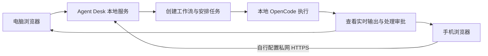
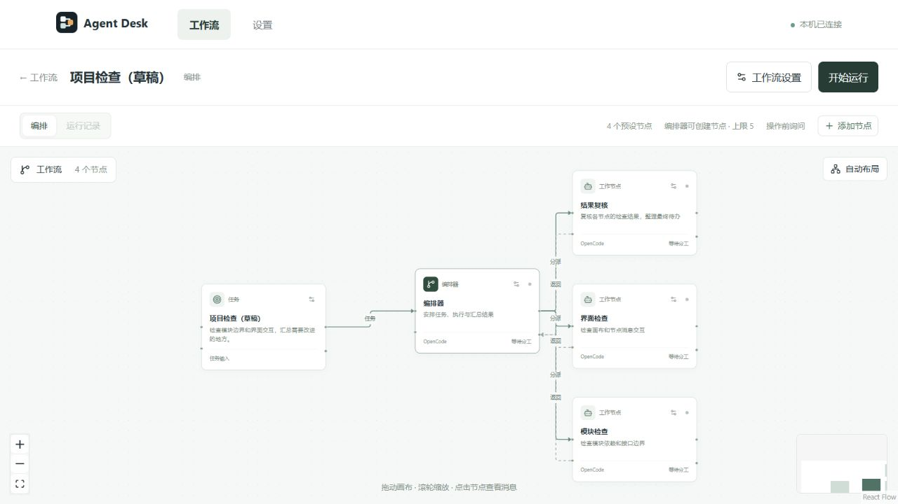
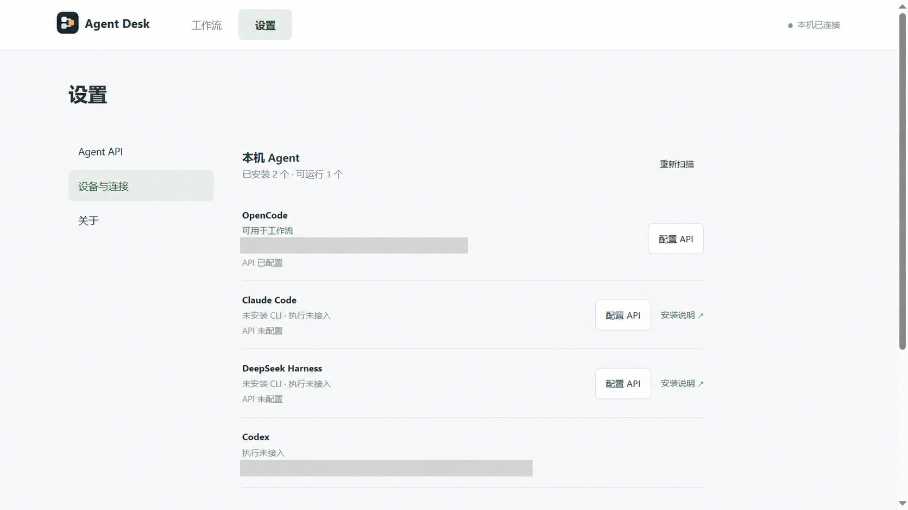

# Agent Desk

多 Agent 工作台：在电脑上运行本地服务，通过浏览器管理工作流、给本地 Agent 分配任务，并查看运行过程。

界面适配电脑和手机。手机访问需要自行配置私网 HTTPS 入口并使用设备连接密码；本地服务默认只监听电脑的回环地址。

## 工作流程


## 使用

在 Windows 上双击 `start.cmd`，或在 PowerShell 中运行：

```powershell
./start.ps1 -NoBrowser
```

在电脑浏览器打开 `http://127.0.0.1:4190/workflows`，按页面提示输入项目运行时生成的设备连接密码。密码文件位于 `.local/agent-desk/connection-password.txt`。

工作台可以创建工作流、安排成员任务、查看输出和处理工具审批。实际执行使用本地安装的 OpenCode；其他 Agent 的配置入口不代表已经支持执行。项目不会修改 Codex 的 API 配置或第三方 CLI 的全局配置。

手机私网连接方法见 [使用说明](docs/independent-demo.md)。

## 界面预览

工作流画布：安排任务与成员节点。



设备与连接：查看本机 Agent 的安装和配置状态。


## 项目结构

- `apps/`：工作台界面和本地服务。
- `packages/`：工作流、运行适配、存储和通信模块。
- `docs/`：使用说明与设计记录。

项目受到 [HAPI](https://github.com/tiann/hapi) 的启发。
